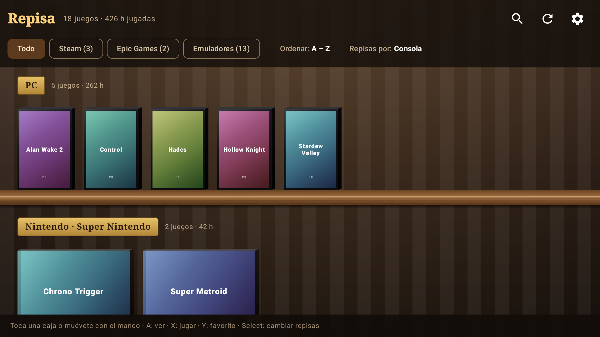

# Repisa

Tu colección de juegos como cajas físicas sobre repisas de madera, al estilo de *Box Room*,
pensada para la **AYN Thor** (Android, doble pantalla) y cualquier consola o móvil Android.


| Repisas por consola | Ficha del juego |
|---|---|
|  |  |

*(Capturas con datos de ejemplo y portadas generadas; con tus cuentas conectadas se ven las carátulas reales.)*

## Qué hace

- **Cada juego es su caja**: el frontal es la carátula real del juego (la de la caja que compras en la tienda)
  y la caja toma exactamente la forma de esa carátula; el lomo y la tapa llevan el color del estuche de su sistema.
  Si un juego no tiene carátula, se genera una con su título y la franja típica del sistema (PS2, Switch, DS…).
- **Ordenar**: A–Z, tiempo de juego, jugado recientemente, año, consola.
- **Repisas por**: género, consola, estudio, plataforma (Steam/Epic/Emuladores), década o favoritos.
- **Búsqueda** por título, género, estudio o consola.
- **Ficha del juego**: la caja sale de la repisa y gira; muestra tiempo de juego, última partida, géneros,
  estudio, año y descripción. Se pueden editar los datos a mano.
- **Segunda pantalla**: en la AYN Thor, la pantalla de abajo muestra la ficha del juego seleccionado.
- **Mando**: cruceta para moverte, A = ficha, X = jugar, Y = favorito, B = atrás,
  L1/R1 = filtrar por plataforma, Select = cambiar tipo de repisa, Start = ajustes.

## Fuentes

| Fuente | Qué lee | Qué necesitas |
|---|---|---|
| **Steam** | Juegos, horas jugadas, última partida, carátula vertical oficial, géneros y estudio | **Vincular cuenta**: iniciar sesión en la web oficial de Steam dentro de la app (usuario o QR). Opción avanzada: clave de API |
| **Epic Games** | Juegos, horas jugadas, carátula vertical, estudio | **Vincular cuenta**: iniciar sesión en la web oficial de Epic (mismo método que Heroic/Legendary) |
| **Carpetas de ROMs** | Un juego por ROM, agrupando discos (.m3u/.cue/.chd) | Elegir la carpeta con subcarpetas por sistema (`snes`, `psx`, `ps2`, `gba`, `switch`…) |
| **ES-DE** | Nombre, género, estudio, año, descripción, última partida y portadas descargadas | Elegir la carpeta `ES-DE` |
| **RetroArch** | Playlists (.lpl) y tiempo de juego (.lrtl) | Elegir la carpeta `RetroArch` y activar *Guardar registros de tiempo de juego* |
| **libretro-thumbnails** | Carátulas escaneadas de las cajas reales para juegos de emulador | Nada (activado por defecto) |
| **IGDB** (opcional) | Géneros, estudio, año y portada para cualquier juego | Client ID y Secret de Twitch (gratis) |

Además, Repisa **mide el tiempo** de los juegos de emulador que abres desde la app
(eliges el emulador de cada sistema en Ajustes; Dolphin, DuckStation, NetherSX2/AetherSX2, PPSSPP,
Flycast y RetroArch tienen arranque directo, el resto se abre con "Abrir con…").

## Compilar

Cada push compila el APK en GitHub Actions (pestaña *Actions* → artefacto `Repisa-apk`).
En local:

```bash
./gradlew assembleRelease   # app/build/outputs/apk/release/app-release.apk
```

Requisitos: JDK 17+ y Android SDK 35. El APK release se firma con la clave debug para poder instalarlo directamente.
