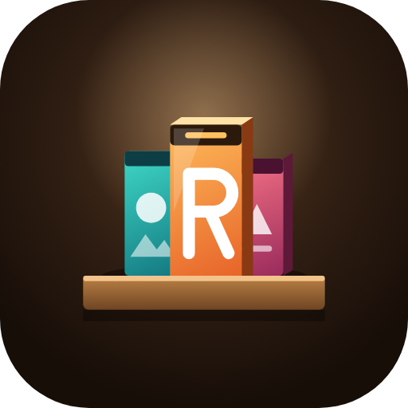
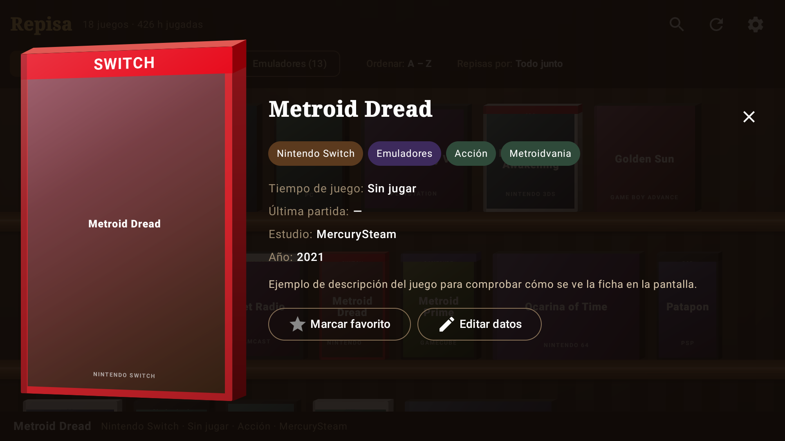
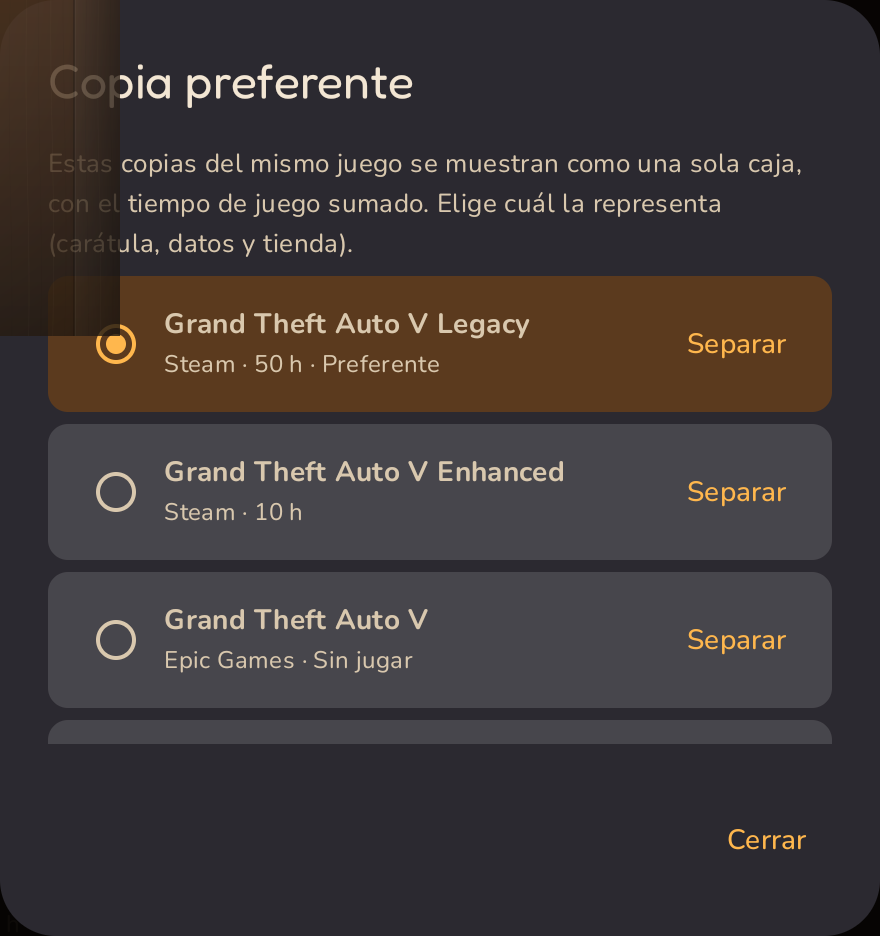
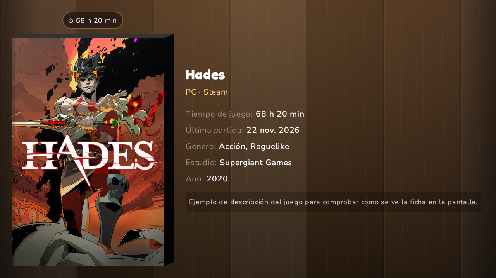
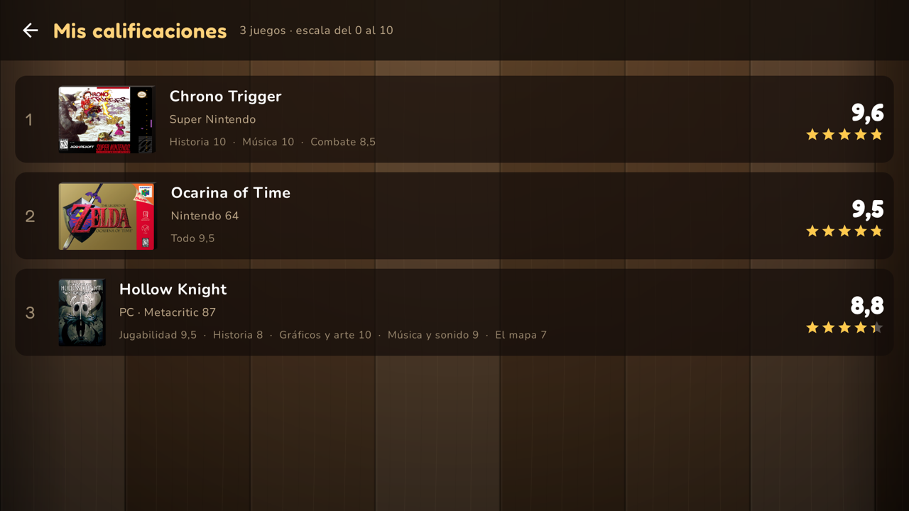
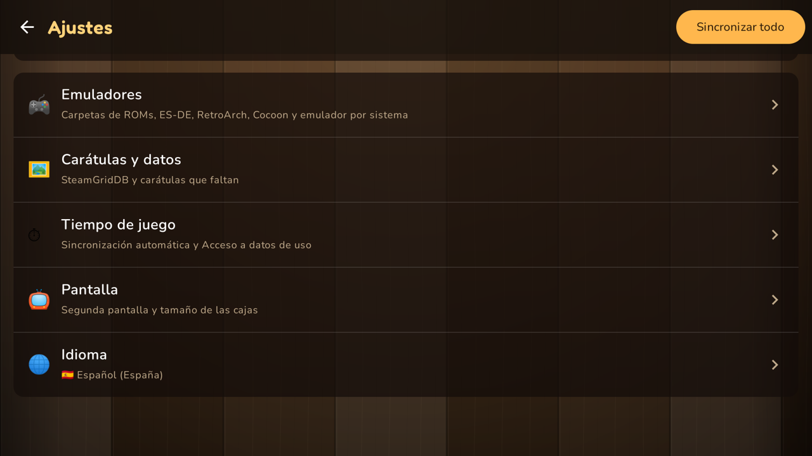
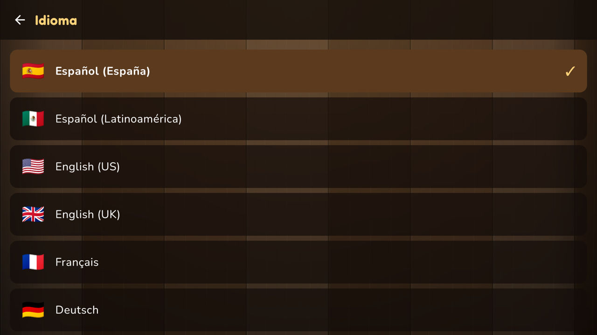

<p align="center">
  
</p>

<h1 align="center">Repisa</h1>

<p align="center">
  Tu colección de videojuegos como cajas físicas sobre una repisa de madera.<br>
  Steam, Epic Games y emuladores en un solo lugar, con su tiempo de juego, sus notas y su carátula.
</p>

<p align="center">
  <a href="../../releases/latest"><b>⬇ Descargar la última versión (APK)</b></a> ·
  <a href="CHANGELOG.md">Novedades</a> ·
  <a href="#english">English</a>
</p>


## ¿Qué es y por qué existe?

En una consola portátil Android como la **AYN Thor** conviven juegos de muchos sitios: tu biblioteca de **Steam**,
la de **Epic Games** y cientos de juegos de **emuladores** (Switch, 3DS, PS2, GameCube, Super Nintendo…). Cada uno
vive en su propia app, con su propia lista y su propio contador de horas.

Repisa los reúne en un solo lugar y los muestra como lo que siempre fueron: **cajas en una estantería**. Cada juego
tiene su carátula real, la caja tiene la forma y el tamaño de la de su consola (una de Switch es más baja que una de
PS2, una de N64 es apaisada…) y puedes ordenar tu colección como quieras: por nombre, por horas, por género, por
consola, por estudio o por la nota que tú le hayas puesto.

Está inspirada en la idea de *Box Room* (ver tu biblioteca como cajas), pero pensada para el mundo de la emulación y
para las consolas portátiles Android con doble pantalla.

## Qué hace

### Tu biblioteca, junta
- **Steam**: juegos propios **y del grupo familiar**, horas jugadas y última partida. Se vincula iniciando sesión en
  la web oficial de Steam (también con el QR de la app de Steam) y **la sesión se renueva sola**: no hay que volver a
  vincular.
- **Epic Games**: juegos y horas jugadas, iniciando sesión en la web oficial de Epic.
- **Emuladores**: carpetas de ROMs ordenadas por sistema, **ES-DE**, **RetroArch** (playlists y tiempo de juego) y
  **Cocoon** / Batocera (`gamelist.xml` exportados y copias de seguridad de Cocoon, con su tiempo de juego).
  Ajustes → Emuladores explica los pasos y muestra qué encontró Repisa.
- **Lo tuyo no se pierde**: si desvinculas una cuenta o un juego desaparece de su tienda, su estado, tu nota, tus
  notas, colecciones y favoritos quedan guardados y vuelven solos cuando el juego regresa.
- **Copias unidas**: el mismo juego en varias ediciones o tiendas (GTA V normal, Enhanced y Legacy, en Steam y en
  Epic) aparece como **una sola caja** con el tiempo sumado. Tú eliges la copia preferente (por defecto, la de Steam).
- **Sin herramientas**: editores, kits de mods, servidores dedicados o paquetes de contenido no aparecen.

### Cajas de verdad
- **Carátula real** en el frontal de cada caja, y la caja toma su forma exacta.
- **Tamaño real** de cada sistema, a escala respecto a una caja de DVD.
- **Buscador de carátulas** en cada ficha y búsqueda automática de las que faltan: **GameTDB** (Switch, 3DS, DS, Wii,
  GameCube, Wii U), **libretro-thumbnails**, **SteamGridDB** y la tienda de Steam. Encuentra la carátula aunque el
  archivo se llame `4262 - Kingdom Hearts 358-2 Days (Europe)` o `Bravely Default 2 NSP eShop`.
- Fondo de **vitrina de nogal** con luz bajo cada balda.

### Tiempo de juego siempre al día
- Steam, Epic y emuladores se vuelven a leer solos cada vez que abres Repisa.
- Con el permiso **Acceso a datos de uso** de Android (el mismo que usa Cocoon), Repisa mide solo el tiempo que el
  emulador está realmente en pantalla en los juegos que abres desde ella.

### Ficha de cada juego



- **Mi nota**, **Metacritic** (prensa y usuarios) y **HowLongToBeat** (historia, + extras y completista).
- Tiempo de juego, última partida, estudio, año, géneros y descripción.
- Botones para jugar (emuladores: Repisa detecta los que tienes instalados y abre el juego directamente), ver en la tienda, marcar favorito, buscar carátula, ver las **copias** y editar datos.

| Copias del mismo juego | Pantalla inferior de la AYN Thor |
|---|---|
|  |  |

### Tu colección, al día
- **Estado de cada juego**: ⏳ Pendiente, ▶ Jugando, ✓ Terminado, ★ 100 %, ✕ Abandonado y ∅ No aplica (para juegos
  sin final como Counter-Strike o Fortnite), con una cinta de color en la caja y «te faltan ~X h» según HowLongToBeat.
- **Estado automático**: sin horas = Pendiente, con horas = Jugando; un Pendiente que juegas pasa solo a Jugando.
- **Repisas por estado** en el orden que tú elijas (por defecto Jugando, Pendiente, Terminado, 100 %, Abandonado,
  No aplica).
- **Selección múltiple**: mantén pulsada una carátula, toca las demás y cambia el estado o la colección de todas a la vez.
- **Colecciones propias** (como las de Steam: «Probar», «Prioridad», «Con amigos»…): repisas tuyas arriba del todo,
  y una página en Ajustes para ver sus juegos, añadir con casillas y buscador, quitar, renombrar y borrar.
- **Repisas plegables**: toca la placa dorada de una repisa para plegarla o desplegarla; se recuerda.
- **Seguir jugando**: los últimos que jugaste, arriba del todo.
- **¿A qué juego? 🎲**: una ruleta de carátulas da de 2 a 4 vueltas y elige por ti (filtros: según tus gustos,
  solo pendientes, plataforma y duración), con botón para jugar directamente.
- **Estadísticas 📊**: horas por sistema y género, juegos por década, terminados, pendientes y los más jugados.
- **Logros 🏆**: los tuyos de Steam con su fecha, la lista de Steam para juegos de Epic (marcándolos a mano),
  RetroAchievements para juegos emulados y logros de Repisa para cualquier juego.
- **Panel en la pantalla de abajo mientras juegas** (AYN Thor y similares): tiempo de la sesión, hora, nota, estado,
  logros y notas.
- **Carátula desde la galería**, encuadrada a la forma de la caja de cada sistema.

### Tus calificaciones



- Calificas lo que tú quieras («Historia», «Música», «El cielo»…), con un **peso en %** y una **nota** cada cosa.
- Escala de 0 a 5, de 0 a 10 o de 0 a 100, y **estrellas que se llenan en proporción** (95/100 = 4¾ estrellas).
- *Mis calificaciones*: ordenadas de mayor a menor (o al revés) y filtrables por estrellas.

### Hecha para consolas portátiles
- **Doble pantalla**: en la AYN Thor, la pantalla de abajo muestra la ficha del juego seleccionado.
- **Mando**: cruceta para moverte, A ficha, X jugar, Y favorito, B atrás, L1/R1 filtrar por plataforma,
  Select cambiar el tipo de repisa, Start ajustes.
- **9 idiomas**: español (España y Latinoamérica), English (US y UK), français, Deutsch, italiano y português
  (Brasil y Portugal). Se elige tocando la bandera la primera vez.

| Ajustes | Idiomas |
|---|---|
|  |  |

## Instalación

1. Descarga `Repisa-X.Y.Z.apk` de la [última versión](../../releases/latest).
2. Ábrelo en tu consola o móvil Android 11 o superior (permite instalar apps de origen desconocido si te lo pide).
3. Elige tu idioma y entra en **Ajustes** para vincular Steam, Epic y tus carpetas de emuladores.

Las versiones nuevas se instalan encima de la anterior sin perder tu biblioteca ni tus notas.

### Recomendado
- **SteamGridDB**: crea una cuenta gratuita, copia tu clave de API (Preferences → API) y pégala en
  Ajustes → Carátulas y datos. Da carátulas para casi cualquier juego.
- **Acceso a datos de uso**: Ajustes → Tiempo de juego → Conceder, para medir bien las horas en emuladores.
- **RetroArch**: activa *Ajustes → Guardado → Guardar registros de tiempo de juego*.

## Fuentes de datos

| Fuente | Para qué | Necesita |
|---|---|---|
| Steam | Juegos, grupo familiar, horas, carátulas, géneros, estudio | Iniciar sesión (o clave de API) |
| Epic Games | Juegos, horas, carátulas, estudio | Iniciar sesión |
| Carpetas de ROMs | Un juego por ROM, agrupando discos | Elegir la carpeta |
| ES-DE / Cocoon / Batocera | Carátulas, géneros, estudio, año, descripción, tiempo de juego | Elegir la carpeta |
| RetroArch | Playlists y tiempo de juego | Elegir la carpeta |
| GameTDB | Carátulas de Nintendo | Nada |
| libretro-thumbnails | Carátulas de consolas clásicas | Nada |
| SteamGridDB | Carátulas de cualquier juego | Clave gratuita |
| Metacritic | Nota de prensa y de usuarios | Nada |
| HowLongToBeat | Duración del juego | Nada |

## Copia de seguridad y versiones nuevas

- **Ajustes → Copia de seguridad y versión → Exportar mis datos** guarda un archivo con tus calificaciones, tiempo
  a mano, favoritos, juegos quitados, copias preferentes, carátulas elegidas y ajustes. **Importar una copia** lo
  recupera (por ejemplo, al cambiar de consola). Las sesiones de Steam/Epic, las claves y las carpetas no se
  guardan en la copia.
- Cada vez que abres Repisa (o vuelves a ella) busca versiones nuevas en las releases de este repositorio. Si hay
  una, muestra sus notas del parche y **hay que actualizar**: la descarga con su progreso y abre el instalador de
  Android, que la instala encima sin perder nada.

## Privacidad

- Todo se guarda **en tu dispositivo**. Repisa no tiene servidores ni cuentas propias.
- Tus contraseñas de Steam y Epic se escriben en sus **páginas oficiales**; Repisa solo recibe el permiso para leer tu
  biblioteca y tus horas.
- Las sesiones de Steam y Epic y las claves (SteamGridDB, Steam API) se guardan **cifradas** con el almacén seguro de
  Android y no entran en las copias de seguridad de Google ni en la de Repisa.

## Compilar

Requisitos: JDK 17+ y Android SDK 35.

```bash
./gradlew assembleRelease          # app/build/outputs/apk/release/app-release.apk
./gradlew testDebugUnitTest        # pruebas
python3 tools/i18n/strings.py      # regenerar los textos de todos los idiomas
```

- Cada cambio se compila en GitHub Actions (*Compilar APK*).
- Para publicar una versión: sube `versionName`, añade su sección a `CHANGELOG.md` y su entrada a
  `releases/versions.json`; el workflow *Publicar versiones* la compila y crea la release con su APK.
- Las traducciones están en `tools/i18n/strings.py` (una columna por idioma).

### Estructura

```
app/src/main/java/com/repisa/app/
  model/      juegos, consolas, géneros, calificaciones, copias
  sources/    Steam, Epic, emuladores, carátulas (GameTDB, libretro, SteamGridDB), Metacritic, HowLongToBeat
  data/       almacenamiento, ajustes, HTTP, carpetas (SAF)
  launch/     abrir emuladores y medir el tiempo de juego
  ui/         repisa, ficha, calificaciones, ajustes, segunda pantalla
  i18n/       idiomas
tools/i18n/   textos de todos los idiomas
docs/         capturas y logo
```

## Licencia

Repisa es software libre bajo la [GNU GPL v3](LICENSE): puedes usarla, estudiarla, compartirla y modificarla, y
las versiones modificadas deben compartirse con la misma licencia.

## Créditos

- [Legendary](https://github.com/derrod/legendary) y [Heroic](https://github.com/Heroic-Games-Launcher): referencia
  para conectar con Epic Games.
- [GameTDB](https://www.gametdb.com), [libretro-thumbnails](https://github.com/libretro-thumbnails) y
  [SteamGridDB](https://www.steamgriddb.com): carátulas.
- Tipografías [Fredoka](https://fonts.google.com/specimen/Fredoka) y
  [Nunito](https://fonts.google.com/specimen/Nunito) (SIL Open Font License, ver `docs/licencias`).

Repisa no está afiliada a Valve, Epic Games, Nintendo, Sony, Sega, AYN, Metacritic ni HowLongToBeat. Las carátulas y
marcas pertenecen a sus dueños.

---

## English

**Repisa** shows your video game collection as physical boxes on a wooden shelf. It brings together your **Steam**
(including Family Sharing), **Epic Games** and **emulator** libraries (ROM folders, ES-DE, RetroArch, Cocoon) with real
cover art, real box sizes per console, up-to-date playtime, Metacritic and HowLongToBeat data, and your own weighted
ratings with stars. Track each game's status (backlog, playing, finished, 100 %, abandoned, not applicable), make your
own collections, let the 🎲 roulette pick your next game, see stats and achievements (Steam, RetroAchievements and
Repisa's own). Built for Android handhelds such as the dual-screen **AYN Thor** (bottom screen shows the selected
game) and fully playable with a controller. Available in 9 languages.

[Download the latest APK](../../releases/latest) · [Changelog](CHANGELOG.md)
