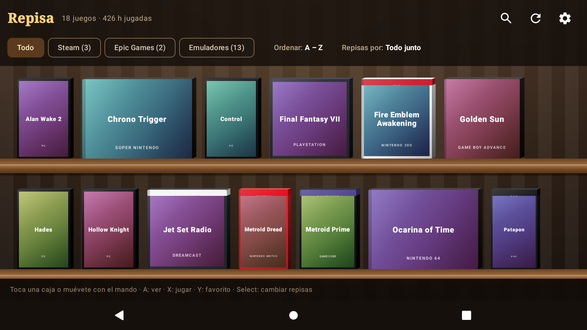

# Repisa

Tu colección de juegos como cajas físicas sobre repisas de madera, al estilo de *Box Room*,
pensada para la **AYN Thor** (Android, doble pantalla) y cualquier consola o móvil Android.



| Repisas por consola | Ficha del juego |
|---|---|
|  |  |

*(Capturas con datos de ejemplo y portadas generadas; con tus cuentas conectadas se ven las carátulas reales.)*

## Idiomas

Español (España y Latinoamérica), English (US y UK), Français, Deutsch, Italiano, Português (Brasil y Portugal).
La primera vez se elige tocando la bandera; después, en Ajustes → Idioma. Los textos están en
`tools/i18n/strings.py`: para añadir un idioma se añade su columna y se ejecuta `python3 tools/i18n/strings.py`.

El logo está en `docs/logo/` (PNG 1024 y 512 y SVG).

## Qué hace

- **Cada juego es su caja**: el frontal es la carátula real del juego (la de la caja que compras en la tienda)
  y la caja toma exactamente la forma de esa carátula; el lomo y la tapa llevan el color del estuche de su sistema.
  Si un juego no tiene carátula, se genera una con su título y la franja típica del sistema (PS2, Switch, DS…).
- **Ordenar**: A–Z, tiempo de juego, jugado recientemente, año, consola.
- **Repisas por**: género, consola, estudio, plataforma (Steam/Epic/Emuladores), década o favoritos.
- **Búsqueda** por título, género, estudio o consola.
- **Ficha del juego**: la caja sale de la repisa y gira; muestra tiempo de juego, última partida, géneros,
  estudio, año y descripción. Se pueden editar los datos a mano.
- **Segunda pantalla**: en la AYN Thor, la pantalla de abajo muestra la ficha del juego seleccionado.
- **Mando**: cruceta para moverte, A = ficha, X = jugar, Y = favorito, B = atrás,
  L1/R1 = filtrar por plataforma, Select = cambiar tipo de repisa, Start = ajustes.

## Fuentes

| Fuente | Qué lee | Qué necesitas |
|---|---|---|
| **Steam** | Juegos propios **y del grupo familiar**, horas jugadas (también en juegos prestados), última partida, carátula vertical oficial, géneros y estudio | **Vincular cuenta**: iniciar sesión en la web oficial de Steam dentro de la app (usuario o QR). Opción avanzada: clave de API (sin grupo familiar) |
| **Epic Games** | Juegos, horas jugadas, carátula vertical, estudio | **Vincular cuenta con código**: la app muestra un código y un QR; se acepta en epicgames.com/activate desde cualquier navegador o el móvil (funciona con cualquier método de inicio de sesión) |
| **Carpetas de ROMs** | Un juego por ROM, agrupando discos (.m3u/.cue/.chd) | Elegir la carpeta con subcarpetas por sistema (`snes`, `psx`, `ps2`, `gba`, `switch`…) |
| **ES-DE** | Nombre, género, estudio, año, descripción, última partida y portadas descargadas | Elegir la carpeta `ES-DE` |
| **RetroArch** | Playlists (.lpl) y tiempo de juego (.lrtl) | Elegir la carpeta `RetroArch` y activar *Guardar registros de tiempo de juego* |
| **libretro-thumbnails** | Carátulas escaneadas de las cajas reales para juegos de emulador | Nada (activado por defecto) |
| **GameTDB** | Carátulas escaneadas de Switch, 3DS, DS, Wii, GameCube y Wii U | Nada |
| **Metacritic** | Nota de la prensa y de los usuarios | Nada |
| **HowLongToBeat** | Horas: historia, + extras, completista | Nada |
| **SteamGridDB** (recomendado) | Carátulas de cualquier juego y plataforma (la base que usa Cocoon) | Clave gratuita |

### Carátulas

- Cada juego tiene un botón **Buscar carátula** en su ficha: busca en GameTDB, libretro-thumbnails, SteamGridDB y la tienda
  de Steam, y eliges la que quieras. La elegida se respeta en futuras sincronizaciones.
- **Buscar carátulas que faltan** (Ajustes) lo hace automáticamente para toda la biblioteca.
- La búsqueda es por **palabras clave**: limpia el nombre de archivo (números de lista como `4262 - `, IDs `[0100…]`,
  versiones, regiones, "NSP", "eShop", "Update"…) y compara palabras, con II = 2, así que `Bravely Default 2 NSP eShop`
  encuentra *Bravely Default II* y `4262 - Kingdom Hearts 358-2 Days` encuentra su caja.
- Cada caja tiene su **tamaño real** a escala: Switch más baja que PS2, DS/3DS pequeñas, N64/SNES apaisadas, Neo Geo
  y PC antiguo enormes.

### Calificaciones propias

- En cada ficha, la **estrella junto a la X** abre el calificador: tú decides qué calificas (Historia, Música,
  "El cielo"…), cuánto pesa cada cosa (%) y qué nota le das. La nota final es la media ponderada.
- Escala a elegir en Ajustes (0-5, 0-10 o 0-100); las notas se convierten solas al cambiarla.
- La nota se ve también en **estrellas que se llenan en proporción** (95/100 = 4¾ estrellas).
- La **estrella de arriba a la derecha** abre *Mis calificaciones*, ordenadas de mayor a menor.
- La plantilla de aspectos y pesos por defecto se edita en Ajustes → Calificaciones.

### Tiempo de juego siempre al día

- **Steam y Epic** se vuelven a leer solos al abrir Repisa o al volver a ella (cada 10 min como mucho): si juegas
  en el PC, las horas nuevas aparecen aquí y Repisa te avisa de qué juegos cambiaron.
- **Emuladores**: se combinan RetroArch (.lrtl), los `gamelist.xml` de ES-DE / Cocoon (Export Metadata) / Batocera
  (`<playtime>`, `<gametime>`…) y lo que mide la propia Repisa. Si dos fuentes registran el mismo juego se toma
  la mayor, para no contar dos veces las mismas partidas.
- Con el permiso **Acceso a datos de uso** (el mismo que usa Cocoon), Repisa mide solo el tiempo que el emulador
  está realmente en pantalla en los juegos que abres desde aquí, sin contar el reposo ni otras apps.

Además, Repisa **mide el tiempo** de los juegos de emulador que abres desde la app
(eliges el emulador de cada sistema en Ajustes; Dolphin, DuckStation, NetherSX2/AetherSX2, PPSSPP,
Flycast y RetroArch tienen arranque directo, el resto se abre con "Abrir con…").

## Compilar

Cada push compila el APK en GitHub Actions (pestaña *Actions* → artefacto `Repisa-apk`).
En local:

```bash
./gradlew assembleRelease   # app/build/outputs/apk/release/app-release.apk
```

Requisitos: JDK 17+ y Android SDK 35. El APK release se firma con la clave debug para poder instalarlo directamente.
